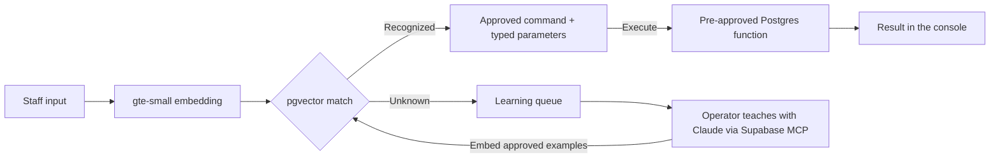

# Backstage

Run a live event desk in plain English. Find missing guests, check someone in, move a table, or undo the last change.

## How it works



For “move table 4 to table 9”, the matcher returns `move_table` and the integers `4` and `9`. The console shows the proposed command before execution. Postgres lets the public client read demo data and call approved functions. User text never becomes SQL. Writes record the previous state so an operator can undo a change. [Backend contract](BACKEND.md) · [Teaching guide](TEACHING.md)

The demo backend runs entirely on the Supabase free plan, with no AI API keys. Supabase runs the embedding model inside the Edge Function. Claude is part of the operator’s teaching workflow, outside the live request path. The Next.js frontend deploys separately to Vercel. [Supabase embeddings](https://supabase.com/docs/guides/functions/ai-models) · [Free plan limits](https://supabase.com/pricing)

## Local setup

1. Use Node.js 22.9+ or 24 LTS. In a new checkout, copy `.env.example` to `.env.local`.
2. Set `NEXT_PUBLIC_SUPABASE_URL` to the Backstage project URL and `NEXT_PUBLIC_SUPABASE_ANON_KEY` to its public publishable or legacy anon key.
3. Run `npm ci`, then `npm run dev`. Open [localhost:3000](http://localhost:3000).

## Demo smoke test

```sh
npx tsx scripts/smoke-test.ts
```

Five phrases should match their expected command. “which table has the most VIPs” and “banana spaceship” should return `unknown`. The table reports status, command, similarity when supplied, and PASS or FAIL. Any failure sets a nonzero exit code.

The script calls only the matcher. It never executes check-in, seating, or undo operations. The matcher itself records unknown phrases in the learning queue.

<details>
<summary>Rebuild the demo backend</summary>

### Rebuild it on your own Supabase project

```bash
supabase link --project-ref <your-ref>
supabase db push                               # applies supabase/migrations/*
psql "$DATABASE_URL" -f supabase/seed.sql      # 40 guests + 56 example phrases
supabase functions deploy match-command embed-commands
supabase secrets set ADMIN_TOKEN=<random-string>
# Embed the phrases (8 per call on the Free plan; repeat until remaining = 0)
curl -X POST "$SUPABASE_URL/functions/v1/embed-commands" -H "x-admin-token: $ADMIN_TOKEN"
```

</details>
