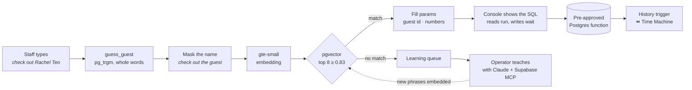

<div align="center">

# Backstage

**The operations console for tonight's show.**<br/>
Run a live event in plain English: find no-shows, check guests in, move a table, rewind a mistake.<br/>
No LLM in the request path · no paid APIs · user text never becomes SQL.

[](https://backstage-chi-six.vercel.app)

[](https://nextjs.org)
[](https://react.dev)
[](https://supabase.com)
[](https://github.com/pgvector/pgvector)
[](https://supabase.com/docs/guides/functions/ai-models)
[](https://backstage-chi-six.vercel.app)

<br/>


</div>

---

## What it does

Event staff type the way they talk. **"who hasn't arrived yet"**, **"check in Sarah Tan"**, **"move table 4 to table 9"**, **"undo that"**. Backstage maps each request onto one of a fixed set of **pre-approved Postgres functions**, shows the SQL it is about to run, and executes it. Reads run immediately; anything that changes the guest list waits for your go.

| | |
|---|---|
| 🗣️ **Plain-English cues** | A built-in `gte-small` embedding plus pgvector finds the closest approved command. No OpenAI, no Anthropic API, nothing to pay for. |
| 🛡️ **Safe by construction** | Text only *selects* a function; parameters are a resolved guest id or plain integers. The public key cannot write to any table. |
| 🎯 **Parameters without an LLM** | Guest names are resolved with `pg_trgm` ("mark Ali as arrived" → *Ali Rahman*, "sara tan" → *Sarah Tan*); numbers from digits or words ("table nine"). |
| ⏪ **Time Machine** | A trigger snapshots every change. *Undo* reverts a whole command (a 4-guest table move is one step); *rewind 10 minutes* replays history backwards. |
| 🎓 **Learns new cues** | Anything it doesn't understand lands in the **learning queue**. An operator teaches it with Claude via the Supabase MCP: one function and 5–7 example phrases, live with no redeploy. |
| 📡 **Live** | Headcounts, the guest list, the queue, history and newly taught cues stream over Supabase Realtime. |

## Try it

Open the **[live demo](https://backstage-chi-six.vercel.app)** and type a cue (press <kbd>/</kbd> to focus the cue box):

| Say… | Backstage runs | Kind |
|---|---|---|
| `who hasn't arrived yet` · `any no-shows?` | `not_checked_in()` | read |
| `who's in the building` | `who_is_inside()` | read |
| `how many VIPs are here` | `vip_inside_count()` | read |
| `who is at table 5` · `show me table nine` | `guests_at_table(p_table)` | read |
| `check in Sarah Tan` · `Rajesh is here` | `check_in_guest(p_guest_id)` | write |
| `check out Rachel Teo` · `Ali has left` | `check_out_guest(p_guest_id)` | write |
| `move table 4 to table 9` | `move_table(p_from, p_to)` | write |
| `undo that` | `undo_last()` | write |
| `rewind the last 10 minutes` | `rewind_minutes(p_minutes)` | write |

Then ask **"which table has the most VIPs"**. Backstage doesn't know that one yet, so it goes to the learning queue, ready to be [taught live](TEACHING.md).

**Keyboard:** <kbd>/</kbd> focus · <kbd>Enter</kbd> call the cue · <kbd>↑</kbd>/<kbd>↓</kbd> recall · <kbd>Esc</kbd> clear.

## How it works



1. **Resolve the guest.** `guess_guest` finds a guest named in the text with whole-word trigram similarity, so first names and small typos work while ordinary words never match.
2. **Mask, then embed.** The name is swapped for *"the guest"* before embedding, so the verb, not the name, decides between check-in and check-out.
3. **Match.** pgvector returns the 8 nearest example phrases above the **0.83** threshold. A ranking guard keeps *"which table has the **most** VIPs"* from being answered as *"how many VIPs"*.
4. **Fill parameters.** The first candidate whose parameters the text can supply wins (*"who is at table 9"* has one number, so it can't be a table move).
5. **Execute.** The console calls the function by name with typed parameters; it returns `{ message, rows, kind, ok }`.

Threshold tuning, the full test matrix and every response shape are in **[BACKEND.md](BACKEND.md)**.

## Security model

- **The browser can't write tables.** The publishable key has `SELECT` on the demo tables and `EXECUTE` on nine whitelisted functions, and nothing else.
- **Writes go only through `SECURITY DEFINER` functions** with a pinned `search_path`; read commands run as `SECURITY INVOKER` under RLS.
- **Matcher internals are server-only.** `match_command`, `guess_guest` and `log_unknown` are callable only by the Edge Function's service role.
- **Private schema.** History trigger, restore logic and the admin-token hash live outside the public API.
- **New functions are locked by default** until explicitly granted. That's the first step of [teaching a cue](TEACHING.md).
- **The admin endpoint** (`embed-commands`) requires an `x-admin-token`; only its SHA-256 hash is stored.

## Tech stack

| Layer | Built with |
|---|---|
| Console | Next.js 16 (App Router, Turbopack) · React 19 · Tailwind CSS 4 · Framer Motion |
| API | Supabase Edge Functions (Deno) · `Supabase.ai` `gte-small` embeddings |
| Data | Postgres · pgvector (HNSW, cosine) · pg_trgm · Row Level Security · Realtime |
| Hosting | Vercel (auto-deploys `main`, Web Analytics) · Supabase Free plan |

## Run it locally

Requires **Node.js 22.9+** (24 LTS recommended).

```bash
git clone https://github.com/Chi944/Backstage.git
cd Backstage
cp .env.example .env.local
```

Fill in `.env.local` (both values are public and safe for the browser):

```bash
NEXT_PUBLIC_SUPABASE_URL=https://xakzepavudmskiegpwqw.supabase.co
NEXT_PUBLIC_SUPABASE_ANON_KEY=<Supabase → Project Settings → API Keys → Publishable key>
```

```bash
npm ci
npm run dev        # http://localhost:3000
```

Without the env vars the console still loads and explains how to connect.

### Smoke test

```bash
npx tsx scripts/smoke-test.ts
```

Sends seven cues to the live matcher and prints PASS/FAIL. Five should match their command; *"which table has the most VIPs"* and *"banana spaceship"* should come back `unknown` (and land in the learning queue). It never executes a command.

<details>
<summary><b>Rebuild the backend on your own Supabase project</b></summary>

```bash
supabase link --project-ref <your-ref>
supabase db push                               # applies supabase/migrations/*
psql "$DATABASE_URL" -f supabase/seed.sql      # 40 guests + 56 example phrases
supabase functions deploy match-command embed-commands
supabase secrets set ADMIN_TOKEN=<random-string>

# Embed the example phrases (8 per call on the Free plan; repeat until "remaining": 0)
curl -X POST "$SUPABASE_URL/functions/v1/embed-commands" -H "x-admin-token: $ADMIN_TOKEN"
```

</details>

## Project structure

```
app/                     Next.js entry (layout, page, global styles)
components/
├── Console.tsx          page shell, cue flow, keyboard handling
├── CommandInput.tsx     the cue box + suggestion chips
├── MatchCard.tsx        matched command, confidence meter, SQL preview, Run cue
├── ResultView.tsx       result table, refusals, undo
├── TimeMachine.tsx      history + Undo last          (stage right)
├── LearningQueue.tsx    unknown requests             (stage left)
├── CueSheet.tsx         every known command
└── StatsBar · LearnedToast · SqlBlock · Panel
lib/
├── useBackstage.ts      data loading + Realtime subscriptions
├── supabase.ts          browser client
├── database.types.ts    generated Supabase types
└── backstage.types.ts   API contract types
supabase/
├── migrations/          schema → Time Machine → commands → realtime → matcher fixes
├── functions/
│   ├── match-command/   text → command + params
│   └── embed-commands/  admin: embed new example phrases
└── seed.sql             40 guests · 9 commands × 6–7 phrases
scripts/smoke-test.ts    matcher smoke test
```

## Documentation

| | |
|---|---|
| **[BACKEND.md](BACKEND.md)** | API contract, response shapes, command catalog, threshold tuning, security model, Time Machine |
| **[TEACHING.md](TEACHING.md)** | Step-by-step: teach Backstage a new cue |
| **[AGENTS.md](AGENTS.md)** | Conventions for coding agents working in this repo |

<div align="center"><br/><sub>Built for a one-hour hackathon with Claude Code, Codex and Cursor · runs entirely on free tiers</sub></div>
