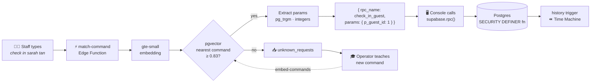

<div align="center">

# 🎛️ Backstage

### A natural-language operations console for live events

Type *"who hasn't arrived yet"* or *"move table 4 to table 9"* and Backstage runs the right, pre-approved database operation.<br/>
**No LLM in the request path. No paid APIs. User text never becomes SQL.**

[](https://supabase.com)
[](https://github.com/pgvector/pgvector)
[](https://supabase.com/docs/guides/functions)
[-FF6F00)](https://supabase.com/docs/guides/functions/ai-models)
[](lib/database.types.ts)

[How it works](#-how-it-works) · [Commands](#-what-it-understands) · [Security](#-security-by-construction) · [Quick start](#-quick-start) · [Backend contract](BACKEND.md) · [Teaching guide](TEACHING.md)

</div>

---

## ✨ Highlights

| | |
|---|---|
| 🗣️ **Plain-English control** | Event staff type the way they talk. A 384-dim `gte-small` embedding plus pgvector finds the closest approved command. |
| 🔒 **Zero SQL injection surface** | Text only *selects* one of nine Postgres functions; parameters are typed integers or a resolved guest id. |
| 🧠 **Parameters without an LLM** | Guest names come from `pg_trgm` fuzzy matching ("mark Ali as arrived" → *Ali Rahman*). Numbers come from digits or words ("table nine"). |
| ⏪ **Time Machine** | Every change is snapshotted by a trigger. *"undo that"* reverts a whole command; *"rewind the last 10 minutes"* replays history backwards. |
| 🎓 **Teachable** | Unknown requests go to a queue. An operator (with Claude via Supabase MCP) adds a function plus 5–7 phrases, and it's live with no redeploy. |
| 📡 **Live** | Guests, the unknown-request inbox and the command catalog stream over Supabase Realtime. |
| 💸 **$0 to run** | Supabase Free plan only. The embedding model runs inside the Edge Function runtime. |

## 🧭 How it works



1. **Match:** the console sends raw text to `match-command`, which embeds it with `gte-small` and asks pgvector for the nearest example phrase.
2. **Extract:** depending on the command's `param_type`, it resolves a guest name (`pg_trgm`) or pulls one or two integers out of the text.
3. **Execute:** the console calls the matched command's Postgres function with those typed params. The function returns `{ message, rows, kind, ok }`.
4. **Remember:** a `BEFORE UPDATE` trigger stores the previous row, so any write can be undone.
5. **Learn:** anything below the threshold is logged for an operator to teach. See [TEACHING.md](TEACHING.md).

## 💬 What it understands

| Say something like… | Command | Params |
|---|---|---|
| *who hasn't arrived yet* · *any no-shows?* | `not_checked_in` | — |
| *who's inside* · *who's in the building* | `who_is_inside` | — |
| *check in Sarah Tan* · *Rajesh is here* | `check_in_guest` | `p_guest_id` |
| *check out Ali* · *Rachel went home* | `check_out_guest` | `p_guest_id` |
| *how many VIPs are here* · *vip headcount* | `vip_inside_count` | — |
| *who is at table 5* · *show me table nine* | `guests_at_table` | `p_table` |
| *move table 4 to table 9* | `move_table` | `p_from`, `p_to` |
| *undo that* · *revert that* | `undo_last` | — |
| *rewind the last 10 minutes* | `rewind_minutes` | `p_minutes` |

Anything else, such as *"which table has the most VIPs"*, comes back as `unknown` and waits to be taught.

## 🔐 Security by construction

- **Read-only clients.** The anon key can `SELECT` from tables and call nine whitelisted functions. It has no `INSERT`/`UPDATE`/`DELETE` grants anywhere.
- **Writes only through `SECURITY DEFINER` functions** with a pinned `search_path`. Read commands run as `SECURITY INVOKER` under RLS.
- **Service-role helpers** (`match_command`, `guess_guest`, `log_unknown`) are callable only from the Edge Function.
- **Private schema** for internals: the history trigger, restore logic, result builder and admin token hash are not exposed through the Data API.
- **Locked-down by default.** New functions are not executable by the frontend until explicitly granted.
- **Admin endpoint** `embed-commands` requires an `x-admin-token`; only its sha256 hash is stored.

## 🚀 Quick start

The backend is already deployed. To point a frontend at it:

```bash
cp .env.example .env.local
# NEXT_PUBLIC_SUPABASE_URL=https://xakzepavudmskiegpwqw.supabase.co
# NEXT_PUBLIC_SUPABASE_ANON_KEY=<Dashboard → Project Settings → API Keys → Publishable key>
```

```ts
import { createClient } from "@supabase/supabase-js";
import type { Database } from "./lib/database.types";
import type { MatchResponse, CommandResult } from "./lib/backstage.types";

const supabase = createClient<Database>(process.env.NEXT_PUBLIC_SUPABASE_URL!, process.env.NEXT_PUBLIC_SUPABASE_ANON_KEY!);

const { data: match } = await supabase.functions.invoke<MatchResponse>("match-command", {
  body: { text: "move table 4 to table 9" },
});

if (match?.status === "matched") {
  const { data } = await supabase.rpc(match.command.rpc_name as any, match.params);
  console.log((data as CommandResult).message); // "Moved 4 guests from table 4 to table 9"
}
```

### Rebuild it on your own Supabase project

```bash
supabase link --project-ref <your-ref>
supabase db push                               # applies supabase/migrations/*
psql "$DATABASE_URL" -f supabase/seed.sql      # 40 guests + 56 example phrases
supabase functions deploy match-command embed-commands
supabase secrets set ADMIN_TOKEN=<random-string>
# Embed the phrases (8 per call on the Free plan; repeat until remaining = 0)
curl -X POST "$SUPABASE_URL/functions/v1/embed-commands" -H "x-admin-token: $ADMIN_TOKEN"
```

## 🗂️ Project structure

```
supabase/
├── migrations/          # 5 tracked migrations: schema → Time Machine → realtime → fixes
├── functions/
│   ├── match-command/   # text → command + params (gte-small + pgvector + pg_trgm)
│   └── embed-commands/  # admin: embed new example phrases in batches
├── seed.sql             # 40 Singapore-diverse guests, 9 commands × 6–7 phrases
└── config.toml
lib/
├── database.types.ts    # generated Supabase types
└── backstage.types.ts   # MatchResponse, CommandResult, …
BACKEND.md               # full API contract, threshold tuning, security model
TEACHING.md              # how to teach a new command
```

## 🎯 Matching quality

The similarity threshold was tuned on 32 phrasings to **0.83**. Correct intents score 0.84–1.00 and nonsense tops out around 0.83. A small **ranking guard** stops "*which table has the **most** VIPs*" from being mistaken for "*how many VIPs*", an error embeddings alone can't separate. Full results are in [BACKEND.md › Matching threshold](BACKEND.md#7-matching-threshold).

## 🧱 Built with

[Supabase](https://supabase.com) (Postgres, Edge Functions, Realtime) · [pgvector](https://github.com/pgvector/pgvector) (HNSW, cosine) · [pg_trgm](https://www.postgresql.org/docs/current/pgtrgm.html) · [gte-small](https://huggingface.co/Supabase/gte-small) via `Supabase.ai.Session` · Deno · TypeScript

<div align="center"><sub>Built for a one-hour hackathon. Backend designed and deployed with Claude Code via the Supabase MCP.</sub></div>
