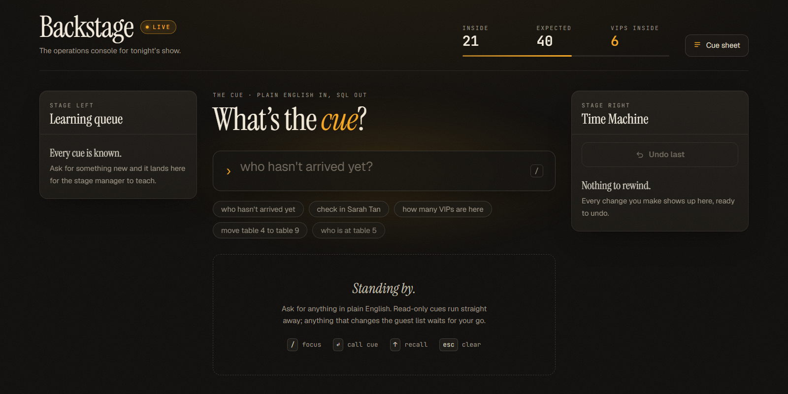
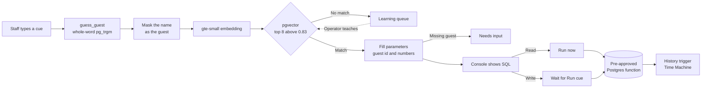

<div align="center">

# 🎭 Backstage

**Run the show in plain English.**

An operations console for live events. Staff type the way they talk ("who hasn't arrived yet",
"check in Sarah Tan", "move table 4 to table 9") and Backstage runs the matching pre-approved
database operation, with every change one click from undo.
No LLM in the request path, no paid API, and user text never becomes SQL.

[](https://backstage-chi-six.vercel.app)
[](https://nextjs.org)
[](https://supabase.com/pricing)
[](https://github.com/pgvector/pgvector)
[-FF6F00)](https://supabase.com/docs/guides/functions/ai-models)
[](https://backstage-chi-six.vercel.app)

[Live app](https://backstage-chi-six.vercel.app) · [Backend contract](BACKEND.md) · [Teaching guide](TEACHING.md)



<sub>Production console against the live seeded event: 21 of 40 guests inside, 6 VIPs.</sub>

</div>

---

## 📋 At a glance

| | |
|---|---|
| **What** | A natural-language operations console for a live event's front desk |
| **Built for** | A one-hour hackathon |
| **Live demo** | [backstage-chi-six.vercel.app](https://backstage-chi-six.vercel.app) |
| **Matching** | Supabase's built-in `gte-small` embeddings + pgvector + pg_trgm, with no LLM or external AI API |
| **Data** | Supabase Postgres (free plan) · project `xakzepavudmskiegpwqw` · Singapore region |
| **Hosting** | Vercel, auto-deploying `main`, with Vercel Web Analytics |
| **Repository** | [github.com/Chi944/Backstage](https://github.com/Chi944/Backstage) |

### Review in 60 seconds

1. Open the [live console](https://backstage-chi-six.vercel.app). The **LIVE** badge and the Inside / Expected / VIPs counts are read straight from the database.
2. Type **`who hasn't arrived yet`** and press <kbd>Enter</kbd>. Reads run immediately: you'll see the match confidence, the SQL it ran, and the 19 guests still expected.
3. Click the **`check in Sarah Tan`** chip. Writes wait for you: review the guest and SQL, press **Run cue**, then press **Undo last** in the Time Machine. The counts go up and back down live.
4. Type **`which table has the most VIPs`**. Backstage doesn't know that yet, so it lands in the **Learning queue**, ready to be [taught](TEACHING.md).

> The demo shares one live database. Please undo anything you change so the next visitor sees the seeded event.

---

## 📖 Table of contents

- [The problem](#the-problem)
- [What Backstage does](#what-backstage-does)
- [Honest status](#honest-status)
- [How it works](#how-it-works)
- [Architecture](#architecture)
- [Getting started](#getting-started)
- [Running the checks](#running-the-checks)
- [Project structure](#project-structure)
- [Known limitations](#known-limitations)
- [Roadmap](#roadmap)
- [Credits](#credits)

---

<a id="the-problem"></a>
## 🧐 The problem

On event night the front desk needs answers fast. *Who's still missing? Is the VIP here yet? Can we merge table 4 into table 9?* The data sits in a database, but staff can't write SQL, and a free-text box that *generates* SQL is a liability: one bad query can wipe the guest list.

Backstage takes the opposite approach. It understands loose English but can only ever **choose** from a short list of operations a developer has already written, reviewed and permissioned.

<a id="what-backstage-does"></a>
## 💡 What Backstage does

- **Understands plain English** using a 384-dimension `gte-small` embedding of the request, compared against 6–7 example phrases per command.
- **Resolves guests and numbers without an LLM.** Names come from whole-word trigram matching ("mark Ali as arrived" → *Ali Rahman*, "sara tan" → *Sarah Tan*); numbers from digits or words ("table nine").
- **Shows before it acts.** Every match displays its confidence and SQL. Reads run straight away; writes wait for **Run cue**.
- **Undoes anything.** A trigger snapshots each change. **Undo** reverts a whole command (moving a table of four is one step) and **rewind N minutes** replays history backwards.
- **Learns new commands.** Unrecognised requests are queued. An operator adds one Postgres function and 5–7 phrases; the console picks the new command up live, with no redeploy.
- **Stays live.** Headcounts, guests, history, the queue and newly taught commands stream over Supabase Realtime.

| You say | Backstage runs | Kind |
|---|---|---|
| `who hasn't arrived yet` · `any no-shows?` | `not_checked_in()` | read |
| `who's in the building` | `who_is_inside()` | read |
| `how many VIPs are here` | `vip_inside_count()` | read |
| `who is at table 5` · `show me table nine` | `guests_at_table(p_table)` | read |
| `check in Sarah Tan` · `Rajesh is here` | `check_in_guest(p_guest_id)` | write |
| `check out Rachel Teo` · `Ali has left` | `check_out_guest(p_guest_id)` | write |
| `move table 4 to table 9` | `move_table(p_from, p_to)` | write |
| `undo that` | `undo_last()` | write |
| `rewind the last 10 minutes` | `rewind_minutes(p_minutes)` | write |

**Keyboard:** <kbd>/</kbd> focus · <kbd>Enter</kbd> call the cue · <kbd>↑</kbd> <kbd>↓</kbd> recall · <kbd>Esc</kbd> clear.

---

<a id="honest-status"></a>
## 🚦 Honest status

**Commit `beb6f40`.** Production at [backstage-chi-six.vercel.app](https://backstage-chi-six.vercel.app) builds from `main` and was verified as follows:

| Area | Verified result |
|---|---|
| Console, end to end | On a local production build against the live database: suggestion chip → match card (100% · Sarah Tan) → **Run cue** → "Checked in Sarah Tan (VIP)" → Time Machine updated live → **Undo last** restored her and the counts |
| Matcher | 21 phrasings run against the live API exactly as the browser calls it, all correct, including undoing a full table move, rewind, the "already checked in" refusal and the unknown path |
| Matcher regression | 32 tuning phrasings re-scored after the matcher fixes; correct intents 0.84–1.00, nonsense ≤ 0.83 |
| Smoke test | `scripts/smoke-test.ts`: **7 / 7 PASS** |
| Production site | Public (200, no login wall); live data; publishable key and project URL present in the client bundle; Web Analytics script served |
| Security | The anon key reads tables and calls 9 functions; a direct `INSERT` is refused (401). Matcher helpers are service-role only |
| Build gates | `tsc --noEmit`, `eslint` and `next build` pass |

**Fixed during verification.** End-to-end testing caught three matcher bugs, now fixed and re-verified:
- *"check out Rachel Teo"* ran **check-in**, because the guest's name dominated the embedding.
- *"check in Bartholomew"* (not a guest) resolved to *Chen Xiu Ling*: "Chen" partially matched "check".
- *"who is at table 9"* matched **move table**.

[BACKEND.md](BACKEND.md#7-matching-threshold) records the scores before and after.

**Not established.** There is no automated unit or UI test suite yet; the checks above are scripted end-to-end runs plus one manual walkthrough. Supabase's security advisor still lists the five write functions as "callable by anon". That is the intended design (it is how the console writes), not an oversight.

---

<a id="how-it-works"></a>
## ⚙️ How it works



### Safety rules and where they're enforced

| Rule | Where it is enforced |
|---|---|
| User text never becomes SQL | `match-command` returns only a function name and typed parameters |
| The browser cannot write tables | No `INSERT`/`UPDATE`/`DELETE` grants for `anon`; RLS allows `SELECT` only |
| Writes go through reviewed code | 5 `SECURITY DEFINER` functions with a pinned `search_path` |
| Matcher internals stay server-side | `match_command`, `guess_guest`, `log_unknown` are executable by `service_role` only |
| New functions start locked | Default privileges revoke `EXECUTE`; teaching includes an explicit grant |
| Every write is undoable | `BEFORE UPDATE` trigger on `guests` writes the old row to `history` |
| Names can't hijack the command | The guest name is masked before embedding, so the verb decides |
| Ranking questions aren't guessed | Words like *most* or *busiest* only match phrases that also rank |
| A missing guest never writes | Guest commands return `needs_input` instead of falling through |

The match threshold is **0.83** (overridable with `MATCH_THRESHOLD`). Tuning data and every response shape are in [BACKEND.md](BACKEND.md).

---

<a id="architecture"></a>
## 🏗️ Architecture

| Layer | Responsibility |
|---|---|
| Console · `app/`, `components/` | Cue input, match card with SQL preview, results, Time Machine, learning queue, cue sheet |
| Client data · `lib/useBackstage.ts` | Initial reads and Realtime subscriptions for guests, history, queue and commands |
| Matcher · `supabase/functions/match-command` | Guest resolution, name masking, embedding, candidate selection, parameter extraction |
| Database · `supabase/migrations` | Tables, RLS, command functions, Time Machine trigger, helper functions, Realtime publication |
| Admin · `supabase/functions/embed-commands` | Embeds new example phrases in batches; protected by `x-admin-token` |

### Built with

| Layer | Choice | Purpose |
|---|---|---|
| Framework | Next.js 16.4.4, React 19.3, TypeScript 5.9 | Console UI, static production build |
| Styling | Tailwind CSS 4.3, Framer Motion 12 | Dark stage theme, panel and result motion |
| Fonts | Geist, Instrument Serif, JetBrains Mono via `next/font` | Interface, display headings and SQL |
| Data | Supabase Postgres, supabase-js 2.118 | RLS-protected tables, RPC calls, Realtime |
| Matching | `gte-small` (Supabase AI), pgvector HNSW, pg_trgm | Intent matching and guest resolution, with no paid API |
| API | Supabase Edge Functions (Deno) | `match-command`, `embed-commands` |
| Hosting | Vercel, Vercel Web Analytics 2.0 | Auto-deploys `main`, page-view analytics |

Six runtime dependencies: `next`, `react`, `react-dom`, `@supabase/supabase-js`, `framer-motion`, `@vercel/analytics`.

---

<a id="getting-started"></a>
## 🚀 Getting started

### Prerequisites

- **Node.js 22.9+** (24 LTS recommended) and npm.
- Network access to the hosted Supabase project; the console has no offline fixture data.

### Install and run

```bash
git clone https://github.com/Chi944/Backstage.git
cd Backstage
cp .env.example .env.local
npm ci
npm run dev
```

Set both values in `.env.local`. They are public and safe in the browser:

```bash
NEXT_PUBLIC_SUPABASE_URL=https://xakzepavudmskiegpwqw.supabase.co
NEXT_PUBLIC_SUPABASE_ANON_KEY=<Supabase → Project Settings → API Keys → Publishable key>
```

Open [localhost:3000](http://localhost:3000). Without the env vars the console still loads and explains how to connect.

### Endpoints

| Route | Purpose |
|---|---|
| `/` | The console |
| `POST /functions/v1/match-command` | `{ text }` → `matched` · `needs_input` · `unknown`. Public, read-only, never executes |
| `POST /rest/v1/rpc/<command>` | Runs one of the 9 approved command functions |
| `POST /functions/v1/embed-commands` | Admin only (`x-admin-token`): embeds new example phrases |

<details>
<summary><b>Rebuild the backend on your own Supabase project</b></summary>

```bash
supabase link --project-ref <your-ref>
supabase db push                               # applies the 8 migrations
psql "$DATABASE_URL" -f supabase/seed.sql      # 40 guests + 56 example phrases
supabase functions deploy match-command embed-commands
supabase secrets set ADMIN_TOKEN=<random-string>

# Embed the phrases (8 per call on the Free plan; repeat until "remaining": 0)
curl -X POST "$SUPABASE_URL/functions/v1/embed-commands" -H "x-admin-token: $ADMIN_TOKEN"
```

</details>

---

<a id="running-the-checks"></a>
## ✅ Running the checks

```bash
npx tsc --noEmit
npm run lint
npm run build
npx tsx scripts/smoke-test.ts
```

The smoke test sends seven cues to the live matcher. Five should match their command; *"which table has the most VIPs"* and *"banana spaceship"* should return `unknown`. It never executes a command, but the matcher does log those two unknowns to the learning queue.

---

<a id="project-structure"></a>
## 📁 Project structure

```text
app/                       Layout, page, global theme, Vercel Analytics
components/                Console, CommandInput, MatchCard, ResultView,
                           TimeMachine, LearningQueue, CueSheet, StatsBar, …
lib/                       Realtime data hook, Supabase client, API and DB types
supabase/migrations/       8 tracked migrations: schema → Time Machine → matcher fixes
supabase/functions/        match-command (matcher) · embed-commands (admin)
supabase/seed.sql          40 guests · 9 commands × 6–7 example phrases
scripts/smoke-test.ts      Live matcher smoke test
docs/                      README imagery
```

| Document | Covers |
|---|---|
| [BACKEND.md](BACKEND.md) | API contract, response shapes, command catalog, threshold tuning, security model, Time Machine |
| [TEACHING.md](TEACHING.md) | Step-by-step guide to teaching Backstage a new command |
| [AGENTS.md](AGENTS.md) | File ownership and rules for coding agents working in this repo |

---

<a id="known-limitations"></a>
## ⚠️ Known limitations

- **No staff sign-in.** Anyone with the link can run the approved commands on the shared demo data. Writes are constrained to the nine functions and every one is undoable, but a real event would need authentication and per-event data.
- **Single demo event.** One seeded event: 40 guests across 10 tables, 8 VIPs, 4 crew.
- **Matching is similarity, not understanding.** Off-topic phrases close to a command can still match a *read*. For example, "how much did the venue cost" lists who's inside. Guest commands never write without a resolved guest.
- **Free-plan limits.** `embed-commands` embeds 8 phrases per call to stay inside the Edge Function CPU budget. A cold Edge Function adds latency to the first request; this hasn't been measured.
- **Test coverage.** Verification is scripted end-to-end runs plus a manual walkthrough; there is no automated unit or UI test suite or CI yet.
- **Rights.** No repository licence has been selected.

<a id="roadmap"></a>
## 🔭 Roadmap

Planned, not built:

- **Teach live on stage.** Add *"which table has the most VIPs"* as a ranking command, following [TEACHING.md](TEACHING.md).
- **Staff accounts.** Supabase Auth with per-event access, replacing the shared anon demo.
- **Multiple events.** Scope guests and history by event.
- **Automated checks.** Matcher regression suite and a UI smoke test in CI, gating Vercel deploys.

---

<a id="credits"></a>
## 👥 Credits

Built by [@Chi944](https://github.com/Chi944).

Built with [Next.js](https://nextjs.org), [React](https://react.dev), [Supabase](https://supabase.com), [pgvector](https://github.com/pgvector/pgvector), [Tailwind CSS](https://tailwindcss.com), [Framer Motion](https://motion.dev) and [Vercel](https://vercel.com). The `gte-small` embedding model runs inside Supabase Edge Functions. Fonts: Geist, Instrument Serif and JetBrains Mono, loaded through `next/font`.

AI coding tools (Claude Code, Codex and Cursor) were used during development. The status section above separates what was verified from what is planned.
